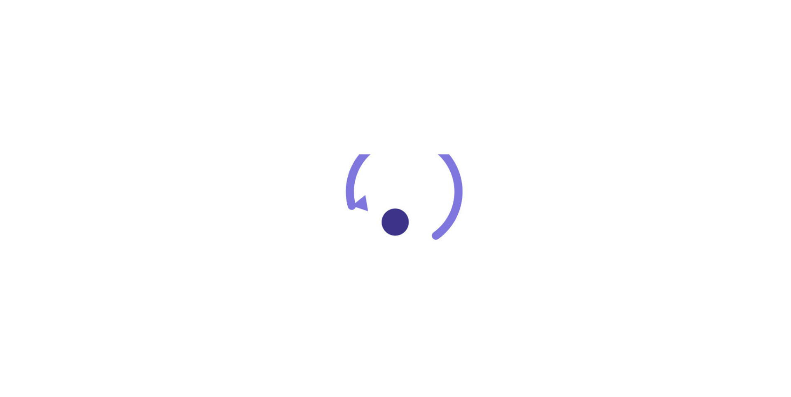

  

  # UndoBase

  **The transactional safety and durability substrate for autonomous AI agents.**

  

    
    
    
    
    
  

  

    Autonomous agents execute mutations across real-world systems with zero isolation, non-deterministic recovery, and no transactional boundaries. 
    UndoBase develops open-source systems infrastructure that guarantees auditability, reversibility, and human authority over agent tool executions.
  

---

## Mission

Modern agent frameworks orchestrate reasoning loops and prompt chains, but treat external side effects as fire-and-forget operations. In production, this lack of boundaries causes critical failures: duplicate financial transfers, uncontrolled data deletions, and uncoordinated state drift.

UndoBase introduces database-grade transaction semantics to agent infrastructure:
* **Write-Ahead Effect Journaling:** Every tool call is intercepted, idempotency-hashed with BLAKE3, and persisted prior to network execution.
* **Deterministic Reversibility:** Tool calls are classified by reversibility (`safe`, `compensable`, `irreversible`). Execution failures trigger compensation sagas in strict LIFO order with exactly-once guarantees.
* **Human-in-the-Loop Gating:** Irreversible operations pause execution and require explicit cryptographic approval before dispatching.
* **Protocol-Native Interception:** Zero monkey-patching. Intercepts traffic at the transport boundary across Model Context Protocol (MCP) and HTTP interfaces.

---

## Ecosystem

### [UndoLog](https://github.com/UndoBase/UndoLog)
The flagship transactional execution runtime and safety gateway for AI agent workflows.

| Component | Language | Scope | Status |
|:---|:---|:---|:---|
| **`undolog-engine`** | Rust | Core gRPC transaction engine, persistent effect journal, and saga orchestrator | `v0.1.0` Live |
| **`undolog-proxy`** | Go | MCP and HTTP reverse proxy with rate limiting, circuit breaking, and Server-Sent Events | `v0.1.0` Live |
| **`undolog-sdk`** | Python | Python SDK with context-var session injection and adapters for LangGraph, CrewAI, Semantic Kernel, and LlamaIndex | `v0.1.0` on PyPI |
| **`@undolog/sdk`** | TypeScript | TypeScript SDK with adapters for Vercel AI SDK, LangChain, Mastra, OpenAI, and MCP clients | `v0.1.1` on npm |
| **`undolog dev`** | Rust / SQLite | Zero-dependency local developer runtime with embedded WAL storage | `v0.1.0` Live |

---

## Core Principles

1. **Determinism over Prompts:** System safety must be enforced by transactional protocols, not model prompt alignment.
2. **Zero Framework Lock-in:** UndoBase integrates at the network boundary. Compatible with LangGraph, CrewAI, OpenAI Agents SDK, or custom runtime loops without code changes.
3. **Radical Transparency:** Architectural decisions are documented in public Architecture Decision Records (ADRs). Fully open source under Apache 2.0.
4. **Systems Engineering Rigor:** Built with memory safety in Rust and high-throughput networking in Go. Validated with cross-language fuzz testing for byte-for-byte canonical JSON parity.

---

## Research & Applied Systems

UndoBase investigates distributed coordination challenges in autonomous computing:
* **Formal Replay Semantics:** Open implementations of bounded replay and checkpointing based on state-of-the-art agent fencing literature (ACRFence).
* **Multi-Agent Distributed Consensus:** Cross-agent effect propagation, distributed deadlock prevention, and decentralized compensation coordination across heterogeneous agent topologies.
* **Policy Attestation:** Cryptographic provenance chains linking model intent, tool invocation arguments, and verified side effects.

---

## Community & Security

* **Documentation:** [undolog.undobase.com](https://undolog.undobase.com)
* **Architecture Decisions:** [UndoLog ADRs](https://github.com/UndoBase/UndoLog/tree/main/docs/adr)
* **Contribution Standards:** Review our [Contribution Standards](https://github.com/UndoBase/UndoLog/blob/main/docs/contributing/COMMIT_AND_PR_STANDARDS.md) before submitting pull requests.
* **Security & Vulnerabilities:** Security reports are handled with priority according to our disclosure policy. Contact [security@undobase.com](mailto:security@undobase.com).

---

  Distributed under the Apache 2.0 License. Maintained by the UndoBase open-source collective.

